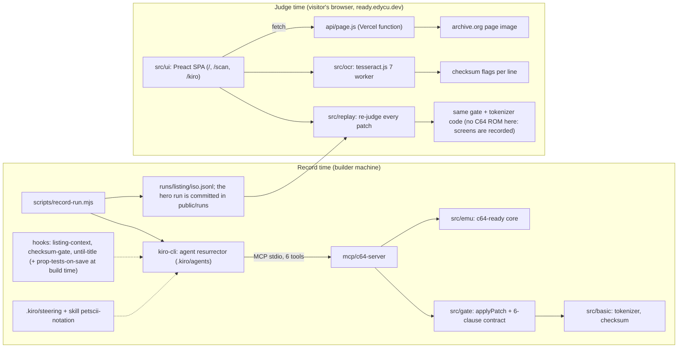

# Architecture

Three times matter: **build time** (Kiro specs and tasks wrote the tokenizer/checksum oracle and the MCP tool layer; the gate, contract, `server.ts` and REPLAY were `claude-direct`), **record time** (a Kiro
agent fixes a listing through the gate on the builder's machine), and **judge time** (the visitor's browser replays and
re-judges that recording). Everything below exists in this repository.

The same map as text:

| Component | Path | Notes |
|---|---|---|
| C64 core | `src/emu/core.ts`, `node.ts`, `session.ts` | `c64-ready` 3.4.0 over the real KERNAL/BASIC; the ROM-bearing WASM is never deployed (`scripts/check-no-rom.mjs`) |
| Tokenizer, notation, checksum | `src/basic/` | KERNAL-equality property test against the real core |
| Gate and contract | `src/gate/checksum-gate.ts`, `contract.ts` | decides line status and the RESURRECTED / BOOTED-PARTIAL / NOT-RESURRECTED verdict |
| MCP server | `mcp/c64-server/` | tools `c64_reload`, `c64_run`, `c64_read_screen`, `c64_press`, `checksum_line`, `apply_patch`; no `node:` import in `tools.ts` |
| Agent | `.kiro/agents/resurrector.json` | `@c64` tools only; file read, shell, write and web denied |
| Hooks | inline in the agent profile; `.kiro/hooks/prop-tests-on-save.json` | scripts in `scripts/hooks/` |
| REPLAY | `src/replay/` | in the deployed browser (RECORDED PLAYBACK): the gate re-judges every patch over the recorded screens and the certificate shows the recorded verdict; with the C64 core (node, `vite dev`) it also re-runs each accepted patch and recomputes the contract; `certificate.ts` renders it |
| OCR | `src/ocr/` | self-hosted tesseract.js 7.0.0 worker, per-column reading for two-column pages |
| Page proxy | `api/page.js` | plain JS (the build tool cannot read TypeScript 7); host allow-list, https-only redirects checked per hop, streamed byte cap |
| Hosting | `vercel.json`, `.github/workflows/` | Vercel only; `ci.yml` and `deploy.yml` |
