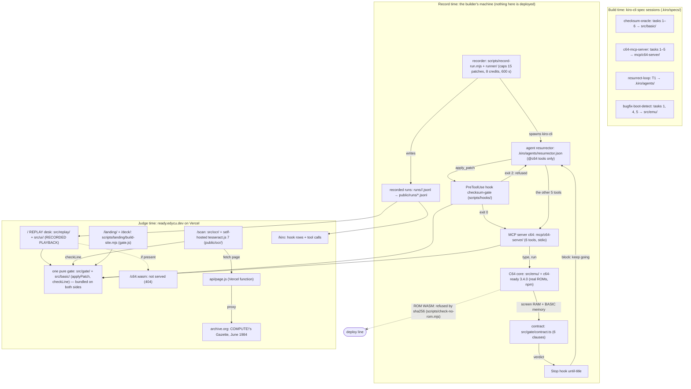

# Architecture

Three times matter: **build time** (Kiro specs and tasks wrote the tokenizer/checksum oracle, the MCP tool layer, the agent
profile and the boot-detect fix; the gate, contract, `server.ts` and REPLAY were `claude-direct`), **record time** (a Kiro
agent fixes a listing through the gate on the builder's machine), and **judge time** (the visitor's browser replays and
re-judges that recording). One pure gate, `src/gate/`, sits on the deploy line: the Kiro PreToolUse hook and the MCP
server call it at record time, and REPLAY, `/scan` and the landing page's `gate.js` call the same file in the browser.
Everything below exists in this repository.

The same map as text:

| Component | Path | Notes |
|---|---|---|
| Kiro specs | `.kiro/specs/` | `checksum-oracle`, `c64-mcp-server`, `resurrect-loop`, `bugfix-boot-detect`; which tasks Kiro ran is in [`docs/DX-REPORT.md`](docs/DX-REPORT.md) |
| Agent | `.kiro/agents/resurrector.json` | `claude-sonnet-5.5`; `@c64` tools only; file read, shell, write and web denied; 3 steering files + skill `petscii-notation` as resources; its three hooks are inline |
| Hooks | `scripts/hooks/`; `.kiro/hooks/prop-tests-on-save.json` | SessionStart `listing-context`, PreToolUse `checksum-gate` (matcher `@c64/apply_patch`, exit 2 refuses), Stop `until-title`; File Save `prop-tests-on-save` runs `tests/prop` at build time |
| Recorder | `scripts/record-run.mjs`, `runner/` | spawns `kiro-cli` headless with one run dir, merges the hook and server events into the run; caps 15 patches, 8 credits, 600 s |
| MCP server | `mcp/c64-server/` | tools `c64_reload`, `c64_run`, `c64_read_screen`, `c64_press`, `checksum_line`, `apply_patch`; no `node:` import in `tools.ts` |
| C64 core | `src/emu/core.ts`, `node.ts`, `session.ts` | `c64-ready` 3.4.0 over the real KERNAL/BASIC; the ROM-bearing WASM is never deployed (`scripts/check-no-rom.mjs`) |
| Gate | `src/gate/checksum-gate.ts`, `src/basic/` | `applyPatch` and `checkLine`: typeable, `:rem` checksum equals the printed one (or fits only a misread printed digit), 40% edit cap; pure and isomorphic, so one file runs in the hook, the MCP server and the browser |
| Contract | `src/gate/contract.ts` | 6 clauses (title seen, post-title text, every line once, checksums, none forced, C64 memory equals the tokenized listing) → RESURRECTED / BOOTED-PARTIAL / NOT-RESURRECTED; needs a C64 core, so it is not recomputed on the public site |
| REPLAY | `src/replay/` | in the deployed browser (RECORDED PLAYBACK): the gate re-judges every patch over the recorded screens and the certificate shows the recorded verdict; with the C64 core (node, `vite dev`) it also re-runs each accepted patch and recomputes the contract; `certificate.ts` renders it |
| OCR | `src/ocr/` | self-hosted tesseract.js 7.0.0 worker (`public/ocr/`), per-column reading for two-column pages; `flag.ts` checks each line with the gate's `checkLine` |
| Landing + deck + judge guide | `scripts/landing/build-site.mjs` → `public/landing/`, `public/deck/`, `public/judge/` | figures read from the run log and evidence files; `gate.js` is the real gate, bundled |
| Page proxy | `api/page.js` | plain JS (the build tool cannot read TypeScript 7); host allow-list (`data/pages.json`), https-only redirects checked per hop, streamed byte cap |
| Evidence | `scripts/rejudge-runs.mjs`, `scripts/live-judge-path.mjs`, `scripts/eval-agents.mjs`, `scripts/bench.mjs`, `evidence/` | every recording re-judged by current code, the judge path on the live URL, agent evals, benchmarks; `evidence/freeze/` pins the sha256 of the files the agent and the gate run on |
| Hosting + CI | `vercel.json`, `.github/workflows/` | Vercel only; six workflows: `CI`, `E2E`, `CodeQL`, `Security`, `Quality`, `Deploy` (deploys `main` after `CI` passes, refuses the ROM WASM by sha256, smoke-tests the live routes) |
