<div align="center">
  
  <h1>SYNTAX ERROR IN 20 🕯️</h1>
  <p><em>A Kiro agent repairs the lines OCR misread in 1984 magazine type-in programs, but only through a gate: a fix must be typeable on a C64 and match its printed checksum (allowing for OCR misreads of the printed digits), and a real C64 core then runs the program and decides the verdict; the live site plays back recorded runs.</em></p>
  

  <br/>

  [](https://ready.edycu.dev)

  [](https://youtu.be/Jv69K3jQ6QI)
  [](JUDGE.md)
  [](https://ready.edycu.dev/kiro)
  [](https://kiroween.devpost.com/)

  <br/>

  
  
  
  
  
  [](https://opensource.org/licenses/MIT)
  [](https://github.com/edycutjong/ready/releases/latest)
  [](https://github.com/edycutjong/ready/actions/workflows/ci.yml)
  [](https://github.com/edycutjong/ready/actions/workflows/e2e.yml)
  [](https://github.com/edycutjong/ready/actions/workflows/codeql.yml)
  [](https://github.com/edycutjong/ready/actions/workflows/security.yml)
  [](https://github.com/edycutjong/ready/actions/workflows/quality.yml)
  [](https://github.com/edycutjong/ready/actions/workflows/deploy.yml)

</div>

---

> **The problem, and who has it.** Anyone typing a 1984 type-in listing back in from a scan: one character the OCR misread
> and the program dies (`?SYNTAX  ERROR IN 20`), and nothing in a plain LLM fix loop stops the model from inventing a line that runs and is wrong.
>
> **What this is.** A Kiro agent that may only change a line through a gate: typeable on a C64 keyboard, within the 40% edit cap, and its checksum
> equals the printed one (or fits only a misread printed digit). The C64 then runs the patched program, and its screen and memory decide the verdict.
> "True" here means exactly that: consistent with the magazine's printed sums and the machine's own output, not proven
> identical to the 1984 text.
>
> **What you can open.** https://ready.edycu.dev plays back three recorded real Kiro runs on pages we typeset in the 1984 format
> (one planted typo; two faults where one runs silently; an error the C64 blames on the wrong line), re-judging each patch in
> your browser. Then type your own fix for the broken line and the same gate judges it, or press Cheat. No C64 ROM is served,
> so nothing on the site runs on a C64 live; the recordings are labelled as recordings.
>
> **Why Kiro:** Kiro specs built the tokenizer/checksum oracle and the MCP tool layer, and Kiro found three places where our own
> spec was wrong about the machine; a Kiro Pre Tool Use hook and the agent's permission profile sit in front of the deterministic
> gate (`src/gate`, claude-direct): the agent has no file, shell or web tools, only six C64 tools.

## 📸 See it in Action

<p align="center">
  
</p>

The 60-second judge path (the three-minute version, with every Kiro file mapped to its evidence, is [`JUDGE.md`](JUDGE.md)):

| Seconds | Do | You see |
|---|---|---|
| 0–20 | Open [ready.edycu.dev](https://ready.edycu.dev) | A 2026-typeset listing (our own page, read by real OCR) under candle light; the recorded run plays itself once (`?still=1` keeps it still): the C64 pane reports `?SYNTAX  ERROR IN 20`, the misread line is struck in red; the agent's patch appears beneath it and re-inks to blue once the gate accepts it. **Resurrect** replays it |
| 20–30 | Press **Cheat** (empties the error line), then edit the line in **fix it yourself** and press **Judge my line** | The gate refuses the deletion; your line is ACCEPTED only if it is typeable, within the 40% edit cap, and its checksum equals the printed one (or fits only a misread printed digit); no C64 runs it |
| 30–40 | Pick **The Ossuary** or **The Ninth Knock** | Harder recorded runs: the C64 blames line 19 while the misprint sits in DATA line 890; a DATA misprint that runs silently is caught by its checksum alone |
| 40–50 | Read the certificate | The certificate of resurrection, then the **IT LIVES** stamp, captioned as recorded, not re-run |
| 50–60 | Open [`/kiro`](https://ready.edycu.dev/kiro) | The Kiro hook rows and tool calls of the three recorded runs, in time order |

Then try [`/scan`](https://ready.edycu.dev/scan): pick one of two June 1984 Gazette pages on archive.org (n177, n178), or upload a scan. Tesseract.js
(self-hosted, in your tab) reads it and each line's recomputed sum is checked against the printed one and the mismatches are flagged. Fix a flagged line by hand and its checksum is rechecked on every keystroke; export the result as `.bas` (unverified lines commented out) plus an errata sheet. The agent's repair is withheld there (see Honest limits).

## 💡 The Problem & Solution

### The Problem
COMPUTE!'s Gazette (1984) printed programs for you to type in, and the program lines we tested carried a checksum (`:rem NNN`). Scans of
those pages are OCR'd with errors, and a single wrong character gives `?SYNTAX  ERROR IN 20` on a machine nobody owns
any more. Nothing stops an LLM asked to "fix the listing" from inventing a line that runs and is wrong.

**Who it is for:** anyone typing a listing back in from a scan. [`/scan`](https://ready.edycu.dev/scan) already checks
each line of a Gazette page or your own scan against its printed `:rem` and flags the mismatches (a sum that fits only a
misread printed digit is marked "digits misread" instead), in the browser (no install, no ROM); you fix a flagged line by hand,
it is rechecked as you type, and you export the `.bas` and an errata sheet. The agent's gated repair is proven on recorded
runs (Engineering Rigor) and withheld on live pages (Honest limits, 4).

### The Solution
The model chooses where to look; code decides what is true. A patch is only accepted when (1) it is typeable on a real
C64 keyboard and (2) its Gazette checksum matches the printed one, or fits only a misread printed digit, and it stays within the 40% edit cap (or the patch is marked `forced`, which can never be
certified); a program only counts as resurrected when (3) the emulated C64 then runs it. The verdict (`RESURRECTED`, `BOOTED-PARTIAL`, `NOT-RESURRECTED`) is
computed from the machine's screen and memory plus the listing's checksums, not from the model's say-so.

The Ossuary shows why the printed checksum, not the error message, says where to look: the C64 blames line 19, line 19
already matches its printed sum, and the checksum points at DATA line 890.

<p align="center">
  
</p>

## 🏗️ Architecture & Tech Stack


Drawn from the code as built: one pure gate (`src/gate/`) sits on the deploy line, called by the Kiro hook and the MCP server at record time and by REPLAY, `/scan` and the landing page in your browser. The table below and [`ARCHITECTURE.md`](ARCHITECTURE.md) give the path behind each component, and ARCHITECTURE.md has the same map as text.

| Layer | What | Where |
|---|---|---|
| Emulator | `c64-ready` 3.4.0 (MIT, npm) drives a headless C64 | `src/emu/` |
| BASIC | Tokenizer, Gazette notation, per-line checksum (tasks 1–6 Kiro-built from a spec) | `src/basic/` |
| Gate | `applyPatch`: typeability, checksum, 40% edit cap, forced-patch bookkeeping; the 6-clause RESURRECTED contract | `src/gate/` (claude-direct) |
| Agent tools | A stdio MCP server with 6 tools: `c64_reload`, `c64_run`, `c64_read_screen`, `c64_press`, `checksum_line`, `apply_patch` | `mcp/c64-server/` |
| Browser | Preact + Vite SPA, REPLAY engine, in-tab tesseract.js 7.0.0 | `src/ui/`, `src/replay/`, `src/ocr/` |
| Server | One Vercel function `/api/page` (archive.org proxy, host allow-list, streamed byte cap) | `api/page.js` |

## 🏆 Kiro Integration (How Kiro was used)

Kiro is the engine, not the decoration. What each `.kiro/` artefact did, and who wrote the code behind it (the gate, contract, `server.ts` and REPLAY were `claude-direct`):

| Artefact | What it did | Evidence |
|---|---|---|
| `.kiro/specs/checksum-oracle/` | Requirements, 7-property design and 12 tasks; Kiro built the tokenizer + checksum (tasks 1–6) and found three places our spec disagreed with the real C64 | [`docs/DX-REPORT.md`](docs/DX-REPORT.md) Day 1 |
| `.kiro/specs/c64-mcp-server/` | Spec (11 properties, 8 tasks) and the zod schemas, run-dir contract and tools (tasks 1–5) | DX report, P1b |
| `.kiro/specs/resurrect-loop/` | The agent loop spec; the agent profile and steering came out of it (T1 done, T2–T6 open) | DX report, P1b |
| `.kiro/agents/resurrector.json` | The shipped agent: only the `@c64` MCP tools; file read, shell, write and web are denied | `tests/unit/resurrector-profile.test.ts`, `evidence/spikes/spike-G.json`, `.kiro/agents/resurrector.json` |
| Hook `checksum-gate` (Pre Tool Use) | Exit 2 refuses an `apply_patch` before it reaches the server | `scripts/hooks/checksum-gate.mjs`, `evidence/spikes/spike-K1.md` (probe profile) |
| Hook `until-title` (Agent Stop) | Blocks the agent's stop while the contract is not RESURRECTED, unless only unfixable lines remain or a cap hits (15 attempts, 8 credits, 600 s). Kiro honours one block per prompt (one forced turn), so `scripts/record-run.mjs` resumes the session between cycles (a safety net: outside E3 it never had to, `docs/EXPERIMENTS.md`); caps are checked between cycles, so one cycle can overshoot the credit cap (E3: 15.21 and 16.68 credits) | `evidence/spikes/spike-K2.md` |
| Hook `listing-context` (Session Start) | Hands the agent the flagged listing | `scripts/hooks/` |
| Hook `prop-tests-on-save` (File Save) | After a save under `src/basic` or `src/gate`, runs `tests/prop` | `evidence/hooks/file-save.jsonl` (4 firings, 1 clean pass) |
| `.kiro/steering/` (7 files; 6 claude-direct, 4 of them in place before Kiro's first session, `product.md` and `commodore-basic-v2.md` committed after its first two; `resurrector.md` written by Kiro in the resurrect-loop session) | Commodore BASIC V2, Gazette notation, the resurrector's rules | `.kiro/steering/` |
| `.kiro/skills/petscii-notation` | PETSCII control-code notation the agent must use | `.kiro/skills/` |
| `.kiro/specs/bugfix-boot-detect/` (bugfix spec) | Current / Expected / Unchanged for two boot-detection bugs we measured (a title shown under 50 frames was missed; printed error-shaped text counted as an error); Kiro wrote the spec and the fix (tasks 1, 4, 5). Our probe and re-judge then caught a stale-screen bug in that fix, fixed claude-direct | `evidence/boot-detect/` (every recording re-judges, 0 mismatches) |
| `.kiro/workflows/resurrect-ab.workflow.yaml` | Two experiment arms in parallel + an aggregator (written claude-direct); ran once headless through `run_workflow` | `evidence/experiments/workflow-run-2026-11-26.md` |
| `powers/c64-resurrect/` (Power) | Packages the skills and the MCP server. Installed, both skills appear in the session catalogue; the Power's MCP server does not connect (suspected causes, not tested: its relative server path, and `RUN_DIR`, without which the server exits) | `evidence/power/activation-2026-11-26.md` |
| Experiments E1–E4 | 18 new real runs (N=2 per arm and case; the shipped case-6 row reuses release 2's 3 runs): Haiku (E1) raised the 1984 page in 1 of 2 runs; with only the error line as context (E3) the 1984 page ended BOOTED-PARTIAL at the credit cap in 2 of 2 runs; Kiro's Agent Stop hook forced one extra turn in 13 of the 17 runs outside E3 (14 new + 3 reused), and the runner never had to resume a session in any of the 17 (E2) | [`docs/EXPERIMENTS.md`](docs/EXPERIMENTS.md) |

Credits are metered by `kiro-cli` and logged per session in [`docs/DX-REPORT.md`](docs/DX-REPORT.md), including two spec lines
that reached or neared their cap (51.26 of 50, 68.71 of 70), after which the tasks we then completed were written `claude-direct` and labelled as such (c64-mcp-server task 8 is still open).

## 📊 Engineering Rigor

| Metric | Value | Source |
|---|---|---|
| Tests | 520 passing, 45 files, plus 1 expected fail (the known-limitation marker, Honest limits 7) (`npm test` on 8d26d13) | `tests/`, `evidence/tests/npm-test-2026-11-26-p7.txt` |
| Agent evals, release 2 | 9 of 9 cases run and passing; cases 5 (silent DATA fault) and 6 (`?OUT OF DATA`) are original 2026 pages | [`docs/EVALS.md`](docs/EVALS.md) |
| Model runs | 12 of 12 `RESURRECTED` with the shipped profile (4 model cases × N=3; the E1–E4 ablation arms are not counted here and include failures). Every recording on disk (35: 20 public, 15 local tier-C) re-judges with 0 mismatches, a run counting only when its recorded and recomputed verdicts are both present and equal | `scripts/rejudge-runs.mjs`, `evidence/boot-detect/rejudge-p6d.json`; the case-3, 5 and 6 runs are in `evidence/evals/runs/`; the case-1 recordings are withheld (rights) and cannot be reproduced from a clone |
| Gate `applyPatch` | p50 0.01 ms, p95 0.05 ms (N=2000, node) | `evidence/bench/bench-2026-11-26-p7.json` (re-run on HEAD 8d26d13 on 2026-11-26; the 11-24 file predates the P1d gate changes and the 11-25 file predates the `src/emu` boot-detect changes) |
| Emulator boot | p50 807 ms (N=10, node) | same file |
| REPLAY of the recorded run in node (incl. a core boot) | p50 2730 ms, range 2.6–3.0 s (N=10) | same file |
| OCR, tesseract.js 7 on the authored page | p50 1199 ms (N=5, warm worker, node) | same file |
| Experiment E0 (does search beat the model?) | On the real 1984 page search fixed 3 of 18 failing lines; the agent made all 18 checksum-consistent (N=2) | [`docs/EXPERIMENTS.md`](docs/EXPERIMENTS.md) |

### Attacks defeated

<p align="center">
  
</p>

| Control | Why it matters | Test |
|---|---|---|
| Cheat: empty the error line | Deleting the failing line would "fix" the error | eval case 4 (deterministic, REFUSED) |
| Forced patch after refusals | A model that insists must not get a certified result | eval case 9: refused, refused, `FORCED`; clause 5 of `src/gate/contract.ts` never certifies it |
| Untypeable line (`™` for `"`) | A line the C64 keyboard cannot produce cannot be "verified" | `tests/unit/checksum-untypeable.test.ts` (checkLine, gate refusal, contract clause 4); eval case 8 is the separate over-80-characters check |
| Proxy host abuse (`/api/page`) | Own-key allow-list, https-only redirects checked per hop, streamed byte cap | `tests/api-page.test.ts` |

### Honest limits

1. The live site is **recorded playback**; no C64 ROM is hosted (rights), so "IT LIVES" there is captioned "as recorded".
2. The 1984 magazine page and its OCR output are not in this repository (rights); that run cannot be reproduced from a clone.
3. On the real 1984 page the title-path result is `19/28` lines source-exact against a vision-read reference; the other lines are checksum-consistent, not proven identical.
4. `/scan` flags checksum mismatches and lets you fix and export lines by hand, but withholds the agent's repair on live pages. On `/`, **fix it yourself** runs your line through the gate only (typeable, checksum, edit cap); no C64 runs it.
5. Evals and experiments use small N on one machine (N=3 per eval case, N=2–3 per experiment arm): directions, not rates.
6. The MEGA65 Open ROMs spike failed (5/5 syntax probes unimplemented), so the C64 core is the one `c64-ready` ships.
7. Title detection reads the program's output below the last screen row that is exactly `RUN`; a program that itself prints a row `RUN` before its title is judged as never reaching the title (measured, probe b in `.kiro/specs/bugfix-boot-detect/bugfix.md`; kept as the 1 expected-fail test).
8. Clause 2 proves the post-title text was not on screen before the press (the title frame and the screen right before the press are both read), not that the key caused it: a program that prints that text by itself on a timer during the 300 frames after the press would still pass. Proving causation needs a second run without the press; the emulator has no snapshot, so it is not done.

## 🚀 Getting Started

### Prerequisites
Node ≥ 22.18.

### Installation
```bash
npm ci
node scripts/vendor-ocr.mjs   # copies the self-hosted tesseract.js worker (needed for /scan)
npm run dev                   # http://localhost:5173
```

## 🧪 Testing & CI

```bash
npm test           # 45 files, 520 tests + 1 expected fail (unit + property + real-core)
npm run typecheck
```
The KERNAL-equality property (`tests/prop/kernal-equality.prop.ts`) types generated lines and the committed `tests/fixtures/crypt.bas` (100 OCR-style mutations) into
the real C64 core and compares its memory with our tokenizer.

Six GitHub Actions pipelines run on every push to `main` (the first five also on pull requests):

| Workflow | What it proves |
|---|---|
| [`CI`](.github/workflows/ci.yml) | every script parses, every JSON file parses, actionlint; `tsc --noEmit`; the test suite on Node 22 and 24; the production build carries no ROM WASM |
| [`E2E`](.github/workflows/e2e.yml) | per commit, `scripts/verify_offline.mjs` replays the recorded run to RESURRECTED on a real in-browser C64 and OCRs a page on `/scan` with every non-local request blocked; after each deploy, `scripts/live-judge-path.mjs` walks the judge path on ready.edycu.dev |
| [`CodeQL`](.github/workflows/codeql.yml) | static analysis of the TypeScript/JavaScript and of the workflow files (`security-extended`) |
| [`Security`](.github/workflows/security.yml) | gitleaks over the whole git history, `npm audit`, dependency review on pull requests |
| [`Quality`](.github/workflows/quality.yml) | Lighthouse CI on `/`, `/kiro`, `/scan`, `/landing/`, `/deck/` (performance ≥ 90, accessibility, best practices and SEO ≥ 95, CLS ≤ 0.1; [`lighthouserc.json`](lighthouserc.json)) and a gzip budget for the judge-path bundle ([`scripts/bundle-budget.mjs`](scripts/bundle-budget.mjs)) |
| [`Deploy`](.github/workflows/deploy.yml) | after `CI` passes on `main`: Vercel build, the ROM WASM refused by sha256, production deploy, a smoke test of the live routes |

## 📁 Project Structure

```
src/basic  src/emu  src/gate  src/ocr  src/replay  src/ui   # the engine and the SPA
mcp/c64-server/   # the stdio MCP server Kiro calls
api/page.js       # the one Vercel function
.kiro/            # specs, steering, agent, hooks, skill, MCP settings
evidence/         # measured runs (spikes, bench, evals, e2e)
docs/             # DX report, evals, experiments
```

## 📽️ Demo Materials

[`JUDGE.md`](JUDGE.md) is the three-minute judge path; [`DEMO.md`](DEMO.md) has the exact commands behind every number. Live: https://ready.edycu.dev

The three GIFs in this README ([`docs/broll/`](docs/broll/)) are captures of the live site at 1× speed (Playwright, Chromium,
2× pixels, nothing on the page altered; the pointer in the gate GIF marks where the scripted clicks landed). The Last Seance and
The Ossuary are the recorded runs the site plays back; the gate GIF is the gate running in the browser.

The demo video was cut on 2026-11-25 at evals release 1, so its receipts read 492 tests and 6 of 6 model runs; the figures in this README are from the later code (release 2 added eval cases 5 and 6).

## 📄 License

MIT for the code in this repository ([`LICENSE`](LICENSE)); [`NOTICE`](NOTICE) states what it does not cover (the Commodore ROMs embedded in the `c64-ready` emulator WASM, magazine pages and listing text).

## 🙏 Acknowledgments

`c64-ready` (MIT) for the C64 core, tesseract.js for OCR, COMPUTE!'s Gazette for the checksum scheme.
