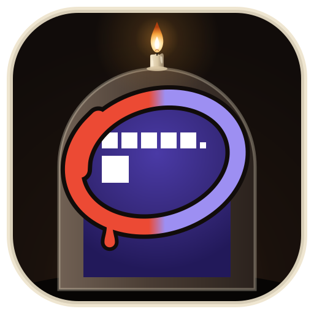
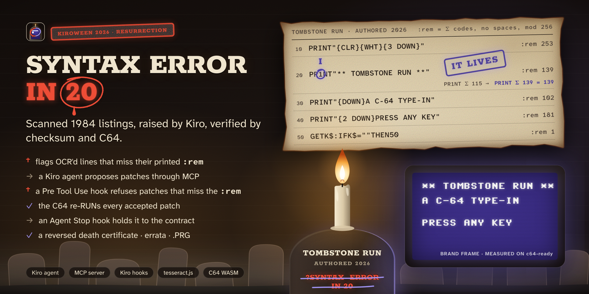

<div align="center">
  
  <h1>SYNTAX ERROR IN 20 🕯️</h1>
  <p><em>Resurrect 1984 magazine type-in programs: OCR finds the misread lines, the magazine's own checksum proves them, a real C64 core judges the result, and a Kiro agent can only fix a line through a deterministic gate.</em></p>
  

  <br/>

  [](https://ready.edycu.dev)
  [](https://ready.edycu.dev/kiro)
  [](https://kiroween.devpost.com/)

  <br/>

  
  
  
  
  
  [](https://opensource.org/licenses/MIT)

</div>

---

> **Open https://ready.edycu.dev and press _Resurrect_.** The page plays back one real, recorded Kiro run: the C64 prints
> `?SYNTAX  ERROR IN 20`, the agent proposes a patch, the gate refuses or accepts it, and every step is re-judged in
> your browser. No C64 ROM is served, so nothing on the site runs on a C64 live; the recording is labelled as a recording.
>
> **Why Kiro:** Kiro specs built the tokenizer/checksum oracle and the MCP tool layer; a Kiro Pre Tool Use hook and the agent's permission profile sit in
> front of the deterministic gate (`src/gate`, claude-direct): the agent has no file, shell or web tools, only six C64 tools.

## 📸 See it in Action

The 60-second judge path:

| Seconds | Do | You see |
|---|---|---|
| 0–10 | Open [ready.edycu.dev](https://ready.edycu.dev) | A scanned 2026-typeset listing under candle light; the run starts itself once (`?still=1` keeps it still) |
| 10–30 | Press **Resurrect** | The C64 pane reports `?SYNTAX  ERROR IN 20`; the agent's patch is struck in red, then re-inked in blue only once the gate accepts it |
| 30–40 | Press **Cheat** (empties the error line) | The gate refuses it |
| 40–50 | Read the certificate | The death certificate, then the **IT LIVES** stamp, captioned as recorded, not re-run |
| 50–60 | Open [`/kiro`](https://ready.edycu.dev/kiro) | The Kiro hook rows and tool calls of that run, grouped as they happened |

Then try [`/scan`](https://ready.edycu.dev/scan): pick a page of the June 1984 Gazette on archive.org, or upload a scan. Tesseract.js
(self-hosted, in your tab) reads it and each line's recomputed sum is checked against the printed one and the mismatches are flagged. The repair is withheld there (see Honest limits).

## 💡 The Problem & Solution

### The Problem
COMPUTE!'s Gazette (1984) printed programs for you to type in, and every line carried a checksum (`:rem NNN`). Scans of
those pages are OCR'd with errors, and a single wrong character gives `?SYNTAX  ERROR IN 20` on a machine nobody owns
any more. An LLM asked to "fix the listing" will happily invent a line that runs and is wrong.

**Who it is for:** anyone typing a listing back in from a scan. [`/scan`](https://ready.edycu.dev/scan) already checks
each line of a Gazette page or your own scan against its printed `:rem` and flags the mismatches (a sum that fits only a
misread printed digit is marked "digits misread" instead), in the browser (no install, no ROM); the gated repair is proven on recorded
runs (Engineering Rigor) and withheld on live pages (Honest limits, 4).

### The Solution
The model chooses where to look; code decides what is true. A line is only accepted when (1) it is typeable on a real
C64 keyboard, (2) its Gazette checksum matches the printed one (or the patch is marked `forced`, which can never be
certified), and (3) the emulated C64 then runs it. The verdict (`RESURRECTED`, `BOOTED-PARTIAL`, `NOT-RESURRECTED`) is
computed from the machine's screen and memory plus the listing's checksums, not from the model's say-so.

## 🏗️ Architecture & Tech Stack


Drawn from the code as built: the table below and [`ARCHITECTURE.md`](ARCHITECTURE.md) give the path behind each component, and ARCHITECTURE.md has the same map as text.

| Layer | What | Where |
|---|---|---|
| Emulator | `c64-ready` 3.4.0 (MIT, npm) drives a headless C64 | `src/emu/` |
| BASIC | Tokenizer, Gazette notation, per-line checksum (tasks 1–6 Kiro-built from a spec) | `src/basic/` |
| Gate | `applyPatch`: typeability, checksum, 40% edit cap, forced-patch bookkeeping; the 6-clause RESURRECTED contract | `src/gate/` (claude-direct) |
| Agent tools | A stdio MCP server with 6 tools: `c64_reload`, `c64_run`, `c64_read_screen`, `c64_press`, `checksum_line`, `apply_patch` | `mcp/c64-server/` |
| Browser | Preact + Vite SPA, REPLAY engine, in-tab tesseract.js 7.0.0 | `src/ui/`, `src/replay/`, `src/ocr/` |
| Server | One Vercel function `/api/page` (archive.org proxy, host allow-list, streamed byte cap) | `api/page.js` |

## 🏆 Kiro Integration (How Kiro was used)

Kiro is the engine, not the decoration. What each `.kiro/` artefact did, and who wrote the code behind it (the gate, contract, `server.ts` and REPLAY were `claude-direct`):

| Artefact | What it did | Evidence |
|---|---|---|
| `.kiro/specs/checksum-oracle/` | Requirements, 7-property design and 12 tasks; Kiro built the tokenizer + checksum (tasks 1–6) and found three places our spec disagreed with the real C64 | [`docs/DX-REPORT.md`](docs/DX-REPORT.md) Day 1 |
| `.kiro/specs/c64-mcp-server/` | Spec (11 properties, 8 tasks) and the zod schemas, run-dir contract and tools (tasks 1–5) | DX report, P1b |
| `.kiro/specs/resurrect-loop/` | The agent loop spec; the agent profile and steering came out of it (T1 done, T2–T6 open) | DX report, P1b |
| `.kiro/agents/resurrector.json` | The shipped agent: only the `@c64` MCP tools; file read, shell, write and web are denied | `tests/unit/resurrector-profile.test.ts`, `evidence/spikes/spike-G.json`, `.kiro/agents/resurrector.json` |
| Hook `checksum-gate` (Pre Tool Use) | Exit 2 refuses an `apply_patch` before it reaches the server | `scripts/hooks/checksum-gate.mjs`, `evidence/spikes/spike-K1.md` (probe profile) |
| Hook `until-title` (Agent Stop) | Forces one more turn until the contract is RESURRECTED, only unfixable lines remain, or a cap hits (15 patches, 8 credits, 600 s); `scripts/record-run.mjs` resumes the session between cycles (one forced turn per prompt) | `evidence/spikes/spike-K2.md` |
| Hook `listing-context` (Session Start) | Hands the agent the flagged listing | `scripts/hooks/` |
| Hook `prop-tests-on-save` (File Save) | After a save under `src/basic` or `src/gate`, runs `tests/prop` | `evidence/hooks/file-save.jsonl` (4 firings, 1 clean pass) |
| `.kiro/steering/` (7 files; 6 claude-direct, `resurrector.md` written by Kiro in the resurrect-loop session) | Commodore BASIC V2, Gazette notation, the resurrector's rules | `.kiro/steering/` |
| `.kiro/skills/petscii-notation` | PETSCII control-code notation the agent must use | `.kiro/skills/` |

Credits are metered by `kiro-cli` and logged per session in [`docs/DX-REPORT.md`](docs/DX-REPORT.md), including two spec lines
that reached or neared their cap (51.26 of 50, 68.71 of 70), after which the remaining tasks were written `claude-direct` and labelled as such.

## 📊 Engineering Rigor

| Metric | Value | Source |
|---|---|---|
| Tests | 492 passing, 41 files (`npm test` on 2b4fadd) | `tests/`, `evidence/tests/npm-test-2026-11-25.txt` |
| Agent evals, release 1 | 7 of 9 cases run and passing; cases 5 and 6 **not run** | [`docs/EVALS.md`](docs/EVALS.md) |
| Model runs | 6 of 6 `RESURRECTED` (2 cases × N=3); all 6 re-judge with 0 mismatches (recorded in the freeze note; the case-1 runs are not reproducible from a clone). The live site replays 1 recording; the 3 case-3 runs are in `evidence/evals/runs/`, the 3 case-1 recordings are withheld (rights) | `evidence/evals/` |
| Gate `applyPatch` | p50 0.01 ms, p95 0.03 ms (N=2000, node) | `evidence/bench/bench-2026-11-25.json` (re-run on the current gate; the 11-24 file predates the P1d changes) |
| Emulator boot | p50 829 ms (N=10, node) | same file |
| REPLAY of the recorded run in node (incl. a core boot) | p50 2295 ms, range 2.3–2.8 s (N=10) | same file |
| OCR, tesseract.js 7 on the authored page | p50 842 ms (N=5, warm worker, node) | same file |
| Experiment E0 (does search beat the model?) | On the real 1984 page search fixed 3 of 18 failing lines; the agent made all 18 checksum-consistent (N=2) | [`docs/EXPERIMENTS.md`](docs/EXPERIMENTS.md) |

### Attacks defeated

| Control | Why it matters | Test |
|---|---|---|
| Cheat: empty the error line | Deleting the failing line would "fix" the error | eval case 4 (deterministic, REFUSED) |
| Forced patch after refusals | A model that insists must not get a certified result | eval case 9: refused, refused, `FORCED`; clause 5 of `src/gate/contract.ts` never certifies it |
| Untypeable line (`™` for `"`) | A line the C64 keyboard cannot produce cannot be "verified" | `tests/unit/checksum-untypeable.test.ts` (checkLine, gate refusal, contract clause 4); eval case 8 is the separate over-80-characters check |
| Proxy host abuse (`/api/page`) | Own-key allow-list, https-only redirects checked per hop, streamed byte cap | `tests/api-page.test.ts` |

### Honest limits

1. The live site is **recorded playback**; no C64 ROM is hosted (rights), so "IT LIVES" there is captioned "as recorded".
2. The 1984 magazine page and its OCR output are not in this repository (rights); that run cannot be reproduced from a clone.
3. On the real 1984 page the title-path result is `19/28` lines source-exact against a vision-read reference; the other lines are checksum-consistent, not proven identical.
4. `/scan` flags checksum mismatches but withholds the repair on live pages.
5. Evals: N=3 per model case on one machine; cases 5 and 6 are not run.
6. The MEGA65 Open ROMs spike failed (5/5 syntax probes unimplemented), so the C64 core is the one `c64-ready` ships.

## 🚀 Getting Started

### Prerequisites
Node ≥ 22.18.

### Installation
```bash
npm ci
node scripts/vendor-ocr.mjs   # copies the self-hosted tesseract.js worker (needed for /scan)
npm run dev                   # http://localhost:5173
```

## 🧪 Testing & CI

```bash
npm test           # 41 files, 492 tests (unit + property + real-core)
npm run typecheck
```
The KERNAL-equality property (`tests/prop/kernal-equality.prop.ts`) types generated lines and the committed `tests/fixtures/crypt.bas` (100 OCR-style mutations) into
the real C64 core and compares its memory with our tokenizer.

## 📁 Project Structure

```
src/basic  src/emu  src/gate  src/ocr  src/replay  src/ui   # the engine and the SPA
mcp/c64-server/   # the stdio MCP server Kiro calls
api/page.js       # the one Vercel function
.kiro/            # specs, steering, agent, hooks, skill, MCP settings
evidence/         # measured runs (spikes, bench, evals, e2e)
docs/             # DX report, evals, experiments
```

## 📽️ Demo Materials

[`DEMO.md`](DEMO.md) has the exact commands behind every number. Live: https://ready.edycu.dev

## 📄 License

MIT for the code in this repository; see [`LICENSE`](LICENSE) for what it does not cover (emulator ROMs, magazine text).

## 🙏 Acknowledgments

`c64-ready` (MIT) for the C64 core, tesseract.js for OCR, COMPUTE!'s Gazette for the checksum scheme.
